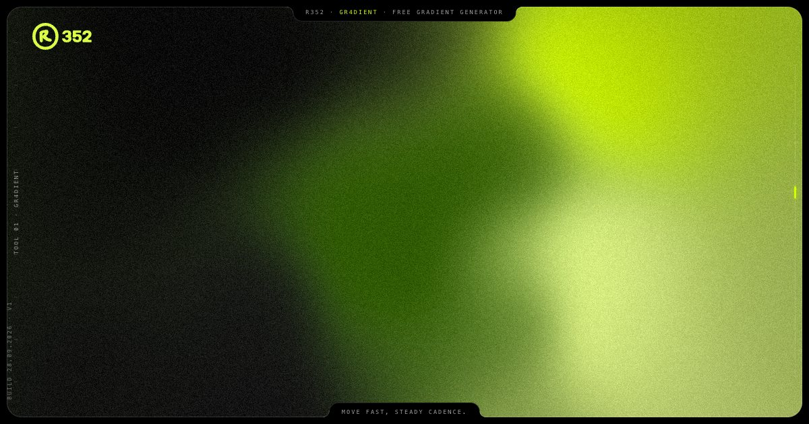

# gr4dient

Animated gradient generator that runs in the browser. Gradients move on the beat: set the tempo
and the number of bars, and every loop ends on the bar, so it cuts cleanly to music.

Live: [r352.com/gr4dient](https://www.r352.com/gr4dient)



## What it does

- Four modes: Field (mesh), Current, Fold and Beam, built from up to five colours.
- 14 presets, draggable colour points, scale, warp, softness and rotation.
- Grain, living grain and dither, plus contrast, saturation and vignette.
- Export: PNG up to 5760 px (screen, 16:9, 1:1, 4:5, 9:16, 3:2, 21:9), a looping video rendered
  frame by frame at 60 fps (MP4 through WebCodecs, WebM where WebCodecs is missing), CSS with grain,
  and an embed snippet that runs the same renderer on any page.
- The link keeps your settings. Nothing is uploaded, there is no sign-up.
- `prefers-reduced-motion` gets one still frame.
- English and Polish interface.

## Run it

It is one HTML file with no build step. Serve the folder with any static host:

```
python3 -m http.server 8000
```

then open http://localhost:8000. GitHub Pages, Vercel or Netlify work the same way.

## Develop

```
npm ci
npm run check    # static checks, ESLint, Prettier
npm run smoke    # the page in headless Chrome
npm run format   # Prettier
```

How the page is built (renderer, state, exports): [ARCHITECTURE.md](ARCHITECTURE.md).

## Files

| File | What it is |
|---|---|
| `index.html` | the whole tool: editor, WebGL renderer, exporters |
| `fonts/PlusJakartaSans-wght.woff2` | interface font (SIL OFL 1.1, see `fonts/OFL.txt`) |
| `og.jpg`, `favicon.svg` | share image and icon |
| `scripts/check.mjs`, `scripts/smoke.mjs` | static check and browser smoke test, both run by CI on every push |

## License

Code: MIT, see [LICENSE](LICENSE). Third-party parts and their licenses:
[THIRD-PARTY-NOTICES.md](THIRD-PARTY-NOTICES.md). The r352 name and logo are not covered by
the MIT license.

Made by [r352](https://www.r352.com). More tools and the studio behind them: [r352.com](https://www.r352.com).
